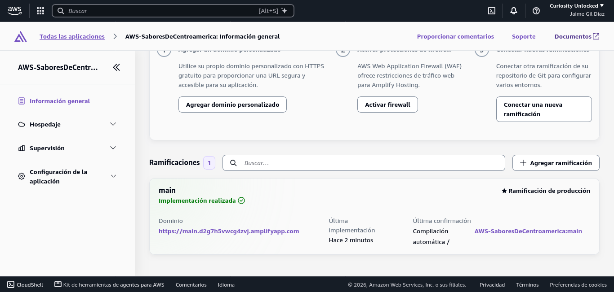
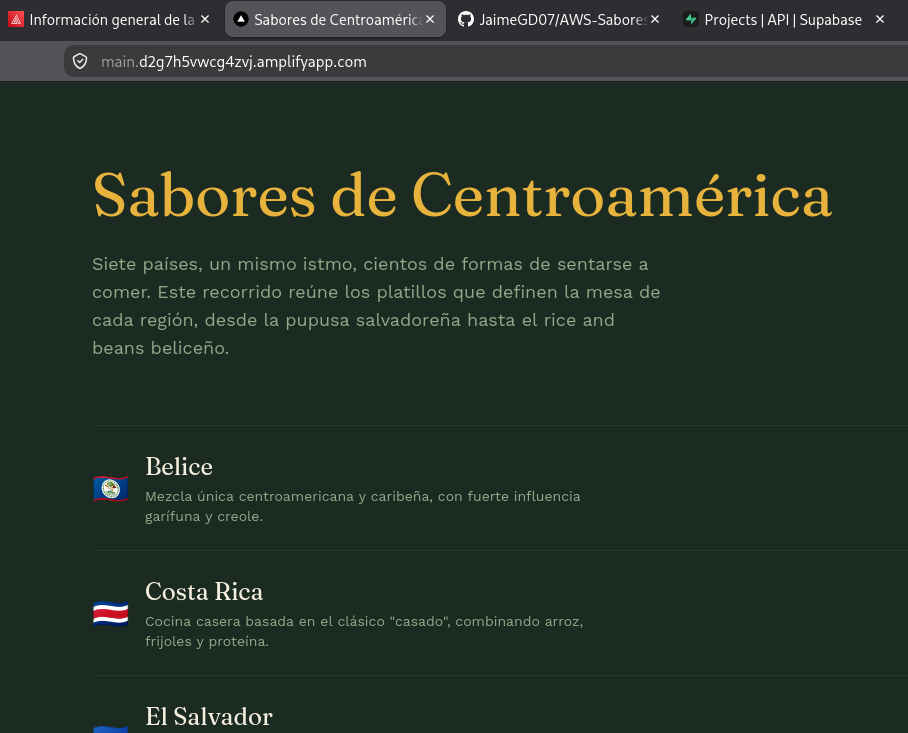

# Sabores de Centroamérica

## Descripción del proyecto

Un recorrido por los platillos típicos de los siete países centroamericanos
(El Salvador, Guatemala, Honduras, Nicaragua, Costa Rica, Panamá y Belice).
Cada país tiene su propia página con la lista de sus platillos, y cada
platillo tiene una página de detalle con su descripción e ingredientes.

**Stack técnico**

- [Next.js 16](https://nextjs.org) con App Router
- [Supabase](https://supabase.com) como base de datos (Postgres) y backend
  serverless, con Row Level Security y Storage para las imágenes
- TypeScript
- Tailwind CSS v4
- Gestor de paquetes: `pnpm`

**Rutas dinámicas**

- `/paises/[slug]` — detalle de un país y sus platillos
- `/platillos/[slug]` — detalle de un platillo, con ingredientes e imagen

Todo el fetching de datos ocurre en Server Components (sin `useEffect` ni
fetching del lado del cliente), consultando Supabase directamente en cada
página.

## Instalación local

1. Clona el repositorio:

   ```bash
   git clone <url-del-repo>
   cd sabores-centroamerica
   ```

2. Instala las dependencias:

   ```bash
   pnpm install
   ```

3. Crea un archivo `.env.local` en la raíz del proyecto con las variables
   de entorno (ver sección siguiente).

4. Corre el servidor de desarrollo:

   ```bash
   pnpm dev
   ```

5. Abre [http://localhost:3000](http://localhost:3000).

## Variables de entorno necesarias

Copia `.env.example` a `.env.local` y completa con los valores de tu
propio proyecto de Supabase (Project Settings → Data API / API Keys):

```bash
NEXT_PUBLIC_SUPABASE_URL=
NEXT_PUBLIC_SUPABASE_ANON_KEY=
```

> La `anon key` es segura de exponer en el frontend — el acceso real está
> controlado por las políticas de Row Level Security configuradas en
> Supabase (ver `supabase/schema.sql`).

## Estructura de datos en Supabase

El esquema completo (tablas, RLS, policies) está en
[`supabase/schema.sql`](./supabase/schema.sql), y los datos de ejemplo en
[`supabase/seed.sql`](./supabase/seed.sql).

- **`paises`**: nombre, slug, bandera (emoji), descripción
- **`platillos`**: nombre, slug, país (FK), descripción, ingredientes, tipo,
  imagen (URL pública desde Supabase Storage)

## Despliegue en AWS

- **URL pública:** https://main.d2g7h5vwcg4zvj.amplifyapp.com/
- **Servicio:** AWS Amplify Hosting (Next.js SSR), región us-east-2, rama `main`.
  Cada `git push` a `main` dispara un nuevo despliegue automático.
- **Build:** definido en [`amplify.yml`](./amplify.yml) (Node 22, pnpm 11.25.0).
  Equivale a `npm run build` del enunciado, pero con `pnpm run build`.
- **Variables de entorno:** `NEXT_PUBLIC_SUPABASE_URL` y `NEXT_PUBLIC_SUPABASE_ANON_KEY`,
  configuradas en la consola de Amplify (nunca en el repositorio). La plantilla
  está en [`.env.example`](./.env.example).
- **Nota:** la home (`/`) se genera en el build; si cambian los datos en Supabase,
  hay que volver a desplegar para verlos. Las rutas `/paises/[slug]` y
  `/platillos/[slug]` se renderizan en cada petición.

### Evidencia del despliegue

Panel de AWS Amplify con el build exitoso (estado: Deployed):



Aplicación funcionando en la URL pública:


